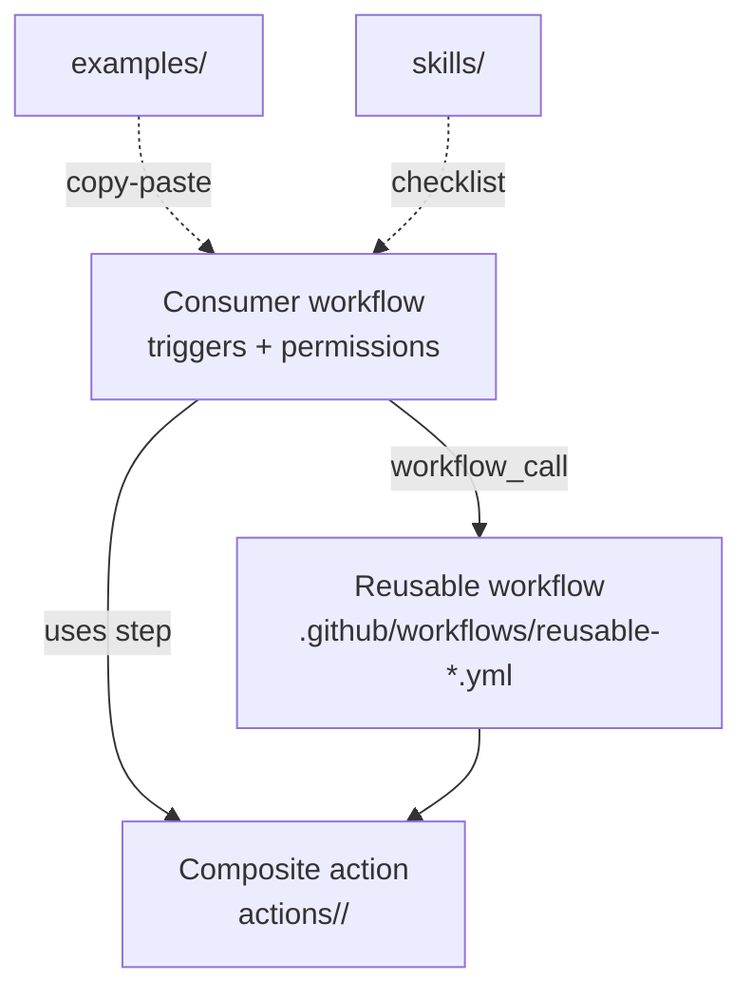

# documentation-actions

[](https://github.com/LLazyEmail/documentation-actions/actions/workflows/ci.yml)
[](./LICENSE)
[](https://github.com/LLazyEmail/documentation-actions/releases)

Reusable **GitHub Actions** and **reusable workflows** for Docusaurus documentation sites and awesome-list repositories.

Extracted from duplicated automation across:

- [LLazyEmail/awesome-email-marketing](https://github.com/LLazyEmail/awesome-email-marketing)
- [LLazyEmail/awesome-newsletters](https://github.com/LLazyEmail/awesome-newsletters)
- [LLazyEmail/documentation](https://github.com/LLazyEmail/documentation)

Modeled on [LLazyEmail/email-template-workflows](https://github.com/LLazyEmail/email-template-workflows).

**Pin** `LLazyEmail/documentation-actions@v1` once released. Draft adoption PRs may use `@main` only during the adoption window. Prefer full SHA + Renovate for production.

## Table of contents

- [For AI agents](#for-ai-agents)
- [Architecture](#architecture)
- [Quick start](#quick-start)
- [Actions and workflows](#actions-and-workflows)
- [Skills](#skills)
- [Adoption](#adoption)
- [Marketplace](#marketplace)

## For AI agents

Start here:

- [AGENTS.md](AGENTS.md) — structured playbook with decision trees and pitfalls
- [docs/quickstart-for-agents.md](docs/quickstart-for-agents.md) — ultra-concise checklist
- [docs/ai-agent-guide.md](docs/ai-agent-guide.md) — step-by-step adoption and extension flows
- [docs/examples-guide.md](docs/examples-guide.md) — when to copy which example
- [docs/inputs-reference.md](docs/inputs-reference.md) — common inputs table
- [docs/pinning.md](docs/pinning.md) — SHA and `@v1` rules
- [docs/troubleshooting.md](docs/troubleshooting.md) — symptom / cause / fix
- [skills/](skills/) — focused checklists (see [skills/README.md](skills/README.md))
- Copy from [examples/](examples/) — never invent job YAML from scratch

## Architecture



- **Reusable workflows** for whole jobs (deploy, changelog, docs-ci, auto-rebase).
- **Composite actions** for shared steps inside custom jobs.
- **Examples** are the source of truth for thin callers.
- Inventory is append-only in [docs/actions-index.md](docs/actions-index.md).

## Quick start

```yaml
# Umbrella docs CI (preferred for greenfield)
jobs:
  docs-ci:
    uses: LLazyEmail/documentation-actions/.github/workflows/reusable-docs-ci.yml@v1
    with:
      working-directory: website
      cache-dependency-path: website/package-lock.json
      run-markdownlint: true
      run-lychee: true
      run-build: true
    secrets: inherit
```

More callers live in [examples/](examples/).

## Actions and workflows

See the append-only inventory: [docs/actions-index.md](docs/actions-index.md).

Detailed reference: [docs/actions/](docs/actions/).

## Skills

Reusable checklists under [skills/](skills/):

- [docusaurus-docs-site](skills/docusaurus-docs-site/SKILL.md) — full site setup and hardening.
- See [skills/README.md](skills/README.md) for the full index.

## Adoption

See [docs/adoption.md](docs/adoption.md), [docs/design.md](docs/design.md), and [docs/pinning.md](docs/pinning.md).

## Marketplace

The root `action.yml` is an umbrella composite (optional markdownlint + lychee + build). Specialized actions and workflows are used by path.

## License

[MIT](./LICENSE) © LLazyEmail
