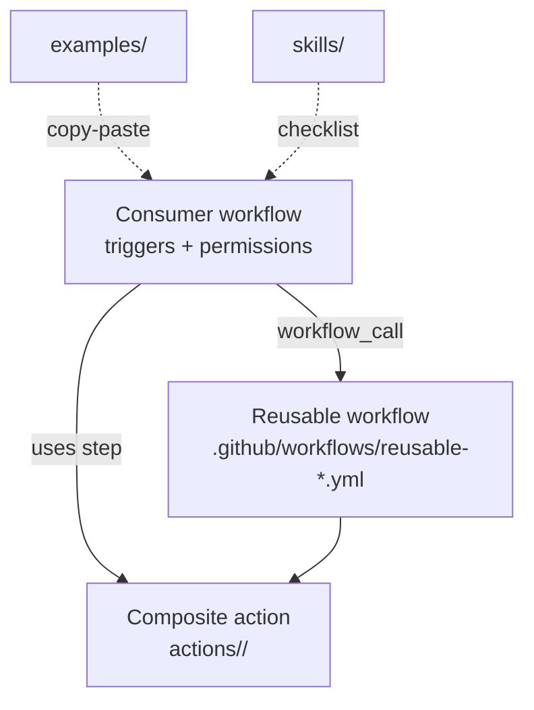

# documentation-actions

[](https://github.com/LLazyEmail/documentation-actions/actions/workflows/ci.yml)
[](./LICENSE)
[](https://github.com/LLazyEmail/documentation-actions/releases)

Reusable **GitHub Actions** and **reusable workflows** for Docusaurus documentation sites and awesome-list repositories.

Extracted from duplicated automation across:

- [LLazyEmail/awesome-email-marketing](https://github.com/LLazyEmail/awesome-email-marketing)
- [LLazyEmail/awesome-newsletters](https://github.com/LLazyEmail/awesome-newsletters)
- [LLazyEmail/documentation](https://github.com/LLazyEmail/documentation)

Modeled on [LLazyEmail/email-template-workflows](https://github.com/LLazyEmail/email-template-workflows).

**Pin** `LLazyEmail/documentation-actions@v1` once released. Draft adoption PRs may use `@main` only during the adoption window. Prefer full SHA + Renovate for production.

## Table of contents

- [For AI agents](#for-ai-agents)
- [Architecture](#architecture)
- [Quick start](#quick-start)
- [Actions and workflows](#actions-and-workflows)
- [Skills](#skills)
- [Adoption](#adoption)
- [Marketplace](#marketplace)

## For AI agents

Start here:

- [llms.txt](llms.txt) — compact entry point
- [AGENTS.md](AGENTS.md) — structured playbook with decision trees and pitfalls
- [docs/architecture.md](docs/architecture.md) — layers and design principles
- [docs/yaml-ai-rules.md](docs/yaml-ai-rules.md) — strict YAML rules
- [docs/naming.md](docs/naming.md) — short-name aliases and v2 plan
- [docs/quickstart-for-agents.md](docs/quickstart-for-agents.md) — ultra-concise checklist
- [docs/ai-agent-guide.md](docs/ai-agent-guide.md) — step-by-step adoption and extension flows
- [docs/examples-guide.md](docs/examples-guide.md) — when to copy which example
- [docs/inputs-reference.md](docs/inputs-reference.md) — common inputs table
- [docs/pinning.md](docs/pinning.md) — SHA and `@v1` rules
- [docs/troubleshooting.md](docs/troubleshooting.md) — symptom / cause / fix, common agent mistakes, and the permissions each caller must grant
- [skills/](skills/) — focused checklists (see [skills/README.md](skills/README.md))
- Copy from [examples/](examples/) — never invent job YAML from scratch

## Architecture



- **Reusable workflows** for whole jobs (deploy, changelog, docs-ci, auto-rebase).
- **Composite actions** for shared steps inside custom jobs.
- **Examples** are the source of truth for thin callers.
- Inventory is append-only in [docs/actions-index.md](docs/actions-index.md).
- Prefer short-name aliases: all nine listed in [docs/naming.md](docs/naming.md) exist (`reusable-pages-deploy`, `reusable-test-deploy`, `reusable-readme-sync`, `reusable-readme-only`, `reusable-label-conflicts`, `reusable-pr-report`, `reusable-thin-content`, `reusable-image-check`, `reusable-entry-format`). Each accepts the same inputs as its long name, and `tests/short-name-aliases.test.sh` keeps it that way.

## Quick start

```yaml
# Umbrella docs CI (preferred for greenfield)
jobs:
  docs-ci:
    uses: LLazyEmail/documentation-actions/.github/workflows/reusable-docs-ci.yml@v1
    with:
      working-directory: website
      cache-dependency-path: website/package-lock.json
      run-markdownlint: true
      run-lychee: true
      run-build: true
    secrets: inherit
```

More callers live in [examples/](examples/).

## Actions and workflows

See the append-only inventory: [docs/actions-index.md](docs/actions-index.md).

### Commit-back workflows (changelog, docs-index, catalog-api)

These run on push to `main`, regenerate a file, and commit it back to `main`.
Several can fire after the same merge, so they push through
[`git-push-retry`](docs/actions/git-push-retry.md): if `main` moved, the push is
rejected, the job runs `git pull --rebase --autostash origin main`, and tries
again (`max-attempts`, default 5). `--autostash` keeps unrelated unstaged files
(LFS-smudged media, build output) from aborting the retry. Callers need
`permissions: contents: write`; nothing else to configure. The workflows use the
action at `@main`, so fixes to it apply without a new release.

Detailed reference: [docs/actions/](docs/actions/).

### Auto-rebase open PRs

`reusable-auto-rebase-prs.yml` keeps open PRs current (schedule, push to `main`
or manual dispatch). Full guide: [docs/auto-rebase.md](docs/auto-rebase.md).

| Input | Default | What it does |
| --- | --- | --- |
| `pr-numbers` | empty (all open PRs) | Comma-separated PRs to update |
| `rebase-conflicts` | `false` | Real git rebase + force-push with SHA lease for conflicting PRs (owner approval). Skips PRs that are already up to date with `main` |
| `report-conflicts` | `false` | Without `rebase-conflicts`, one comment per head SHA listing conflicting files |
| `comment-on-update` | `true` | Comment after a successful update |
| `merge-fallback` | `false` | With `rebase-conflicts`, do a non-force merge update when the rebase conflicts but GitHub says the PR is mergeable |
| `supersede-fork-prs` | `false` | Fork PRs that conflict or can't be updated get a new base-repo PR (`supersede/pr-N`, body starts with `Supersedes #N`); never pushes to the fork. If the contributor force-pushes, their current change is synced in as one fast-forward commit. States that need a maintainer are commented on the PR and logged as warnings, not failures |
| `supersede-union-paths` | empty | Globs (e.g. `README.md website/docs/**/*.md`) where an addition-only conflict keeps both sides |
| `supersede-draft` | `true` | Open supersede PRs as drafts |
| `supersede-sync-message` | thank-you text | With `supersede-fork-prs`, the comment posted on the contributor's PR (once per head SHA) when their new or rewritten commits are synced into the supersede PR. Placeholders `{author}`, `{sha}`, `{supersede}`, `{number}` |
| `delegate-bot-rebase` | `false` | Renovate/Dependabot PRs that are behind or conflicting: ask the bot to rebase (tick Renovate's rebase checkbox, or comment `@dependabot rebase`) instead of a git rebase; logged as delegated, never a failure |
| secret `AUTO_REBASE_TOKEN` | unset | Token so updated branches re-run CI |

Pair `supersede-fork-prs` with
[`reusable-close-superseded-prs.yml`](.github/workflows/reusable-close-superseded-prs.yml)
([example](examples/close-superseded-prs.yml)): when a PR whose body says
`Supersedes #N` merges, #N is closed with a thank-you comment (GitHub's
`Closes #N` keyword does not close PRs).

### Docs sync feedback for contributors

`reusable-sync-feedback.yml` is opt-in. Call it from a `pull_request_target` caller
([example](examples/sync-feedback.yml)) next to `reusable-readme-sync`. When a PR, forks
included, changes `README.md` without the matching docs page, it adds a `needs-docs-sync`
label and posts **one** comment. The comment names the docs file, section, neighbouring entry
and the exact line to add, and is edited in place on later pushes. When the PR is in sync,
the label is removed and the comment says "resolved". The job never checks out PR code.
Set `post-comment: false` on `reusable-readme-sync` to avoid its older generic comment.
Guide: [docs/actions/docs-sync-feedback.md](docs/actions/docs-sync-feedback.md).

## Skills

Reusable checklists under [skills/](skills/):

- [docusaurus-docs-site](skills/docusaurus-docs-site/SKILL.md) — full site setup and hardening.
- See [skills/README.md](skills/README.md) for the full index.

## Adoption

See [docs/adoption.md](docs/adoption.md), [docs/design.md](docs/design.md), and [docs/pinning.md](docs/pinning.md).

## Marketplace

The root `action.yml` is an umbrella composite (optional markdownlint + lychee + build). Specialized actions and workflows are used by path.

## License

[MIT](./LICENSE) © LLazyEmail
